### Versi 2.0

September 2026

# PEMROGRAMAN WEB

**MODUL 4 - LARAVEL REST API: CRUD, ELOQUENT ORM &**

**RELATIONSHIP**

**Author:**

Christian Sri Kusuma Aditya, S.Kom., M.Kom

Nisrina Nurhafizhah

Shofwan Alif Alfani

**LABORATORIUM INFORMATIKA**

**Universitas Muhammadiyah Malang**

**DAFTAR ISI**

**DAFTAR ISI...................................................................................................................................2**

**PENDAHULUAN........................................................................................................................4**

TUJUAN.......................................................................................................................................... 4

TARGET MODUL.............................................................................................................................4

PREPARATION................................................................................................................................4

KEYWORDS.....................................................................................................................................4

**MATERI......................................................................................................................................... 5**

**1. Instalasi & Struktur Laravel.................................................................................................... 5**
1.1. Instalasi Laravel 12...........................................................................................................5

1.2. Struktur Folder Laravel..................................................................................................... 6

1.3. Artisan CLI........................................................................................................................7

**2. Database, Migration & Eloquent ORM................................................................................... 7**
2.1. Konfigurasi .env dan Koneksi MySQL.............................................................................. 7

Langkah 1. Pastikan MySQL berjalan................................................................................7

Langkah 2. Buat Database Terlebih Dahulu...................................................................... 8

Langkah 3. Sesuaikan File .env.........................................................................................8

Langkah 4. Tes Koneksi.....................................................................................................8

2.2. Migration...........................................................................................................................9

2.3. Eloquent ORM.................................................................................................................11

2.4. Accessor, Mutator & Query Scope..................................................................................12

2.5. Seeder & Factory............................................................................................................13

**3. Controller, Routing & Validasi.............................................................................................. 15**
3.1. Controller & API Resource..............................................................................................15

3.2. API Routing.....................................................................................................................16

3.3. Form Request Validation................................................................................................ 17

**4. CRUD API & Relationship..................................................................................................... 18**
4.1. CRUD API Lengkap........................................................................................................19

4.2. Eloquent Relationship.....................................................................................................21

4.3. Relasi Many-to-Many (belongsToMany)......................................................................... 22

4.4. Menjaga Konsistensi Data pada Custom Action (Race Condition).................................24

4.5. Pengujian Endpoint.........................................................................................................26

4.6. Error Handling Dasar......................................................................................................26

**CODELAB...................................................................................................................................27**

Melengkapi REST API Peminjaman Buku Perpustakaan......................................................27

Setup Awal.............................................................................................................................27

Catatan Pengerjaan...............................................................................................................27

Perhatian............................................................................................................................... 27

Referensi Kode yang Sudah Lengkap...................................................................................27

Output yang Diharapkan........................................................................................................28

2

Troubleshooting..................................................................................................................... 28

**DEMO..........................................................................................................................................29**

Ketentuan Demo....................................................................................................................29

Alur yang Diharapkan............................................................................................................ 29

Pengujian...............................................................................................................................30

**RUBRIK PENILAIAN.................................................................................................................. 31**

3

**PENDAHULUAN**

**TUJUAN**

1.​ Memberikan pemahaman kepada mahasiswa mengenai konsep dasar Laravel sebagai

framework backend serta perannya dalam pengembangan REST API

2.​ Membekali mahasiswa dengan kemampuan mengelola database menggunakan migration dan

Eloquent ORM

3.​ Memberikan pemahaman mengenai penerapan CRUD API lengkap beserta relasi antartabel

menggunakan Laravel

**TARGET MODUL**

1.​ Mahasiswa mampu menginstal dan memahami struktur proyek Laravel 12

2.​ Mahasiswa mampu merancang database menggunakan migration dan menghubungkannya

dengan Model melalui Eloquent ORM

3.​ Mahasiswa mampu membangun REST API CRUD lengkap dengan validasi input dan relasi

antartabel

**PREPARATION**

1.​ Bagi mahasiswa Muslim, disunnahkan membaca doa berikut sebelum memulai praktikum

## ُرَضِ يْت

## ِبِاهلل رَبًّا

## ِوَ بِاِإلسْاَل م دِيْنًا

## ٍوَ بِمُحَمَّد نَبِيًّا

## . لوَ رَسُوْ اً.

2.​ Laptop or personal computer

3.​ Text editor atau IDE (disarankan Visual Studio Code) dengan ekstensi PHP Intelephense

4.​ Postman atau aplikasi sejenis untuk menguji endpoint API

5.​ Strong motivation and commitment to learning

**KEYWORDS**

Laravel, REST API, Migration, Eloquent ORM, CRUD, Relationship

4

**MATERI**

**1.​ Instalasi & Struktur Laravel**

Laravel adalah framework PHP yang dibangun di atas konsep Object-Oriented

Programming (OOP) yang sudah dipelajari pada Modul 3, namun dilengkapi dengan berbagai

fitur bawaan seperti routing, database handler, dan validasi, sehingga pengembangan aplikasi

web menjadi lebih cepat dan terstruktur. Jika pada Modul 3 kita membangun struktur project

secara manual dengan memisahkan class ke dalam folder src/, maka Laravel sudah

menyediakan struktur folder standar yang siap dipakai sehingga developer tidak perlu

merancang arsitektur dari nol.

**1.1. Instalasi Laravel 12**

Sebelum memulai, pastikan PHP versi 8.2 atau lebih tinggi, Composer, dan Node.js

sudah terinstal di perangkat masing-masing (cek kembali Modul 0 untuk instalasi Node.js &

npm jika diperlukan). Laravel dapat diinstal menggunakan Composer dengan mengetikkan

perintah berikut di terminal:

_Gambar 1.1: Perintah instalasi Laravel via Composer_

Setelah proses instalasi selesai, masuk ke folder project dan jalankan server

development dengan perintah:

_Gambar 1.2: Perintah menjalankan server development (php artisan serve)_

Jika

berhasil,

Laravel

akan

menampilkan

alamat

lokal

(biasanya

[http://127.0.0.1:8000](http://127.0.0.1:8000)) yang dapat diakses melalui browser untuk mengonfirmasi

bahwa instalasi telah berjalan dengan baik.

Catatan penting: Mulai Laravel 11 (termasuk Laravel 12), file routes/api.php

tidak tersedia secara default saat instalasi baru, berbeda dengan versi Laravel sebelumnya.

Struktur

routing

disederhanakan

sehingga

instalasi

awal

hanya

menyediakan

routes/web.php.

Untuk mengaktifkan routing API, jalankan perintah berikut satu kali setelah instalasi:

_Gambar 1.3: Perintah mengaktifkan routing API (install:api)_

5

Perintah

ini

akan membuat file routes/api.php secara otomatis dan

mendaftarkannya ke bootstrap/app.php. Tanpa langkah ini, seluruh route yang

didaftarkan di routes/api.php tidak akan pernah terbaca oleh php artisan

route:list, meskipun kode Controller dan route sudah benar.

**1.2. Struktur Folder Laravel**

Berbeda dengan struktur folder manual yang dibuat pada Modul 3, Laravel sudah

menyediakan struktur folder standar dengan fungsi masing-masing yang perlu dipahami

sebelum mulai membangun API:

_Tabel 1.1: Struktur folder Laravel (app/Http/Controllers, app/Models, database/migrations,_

_dst.) beserta fungsinya_

**Folder/File**

**Fungsi**

app/Http/Contro

Menyimpan seluruh controller yang menangani request dan

response

llers

app/Models

Menyimpan seluruh model yang berhubungan dengan Eloquent

ORM

database/migrat

Menyimpan file migrasi untuk struktur tabel database

ions

database/seeder

Menyimpan file seeder untuk data dummy

s

| routes/api.php | Mendefinisikan endpoint API |
| --- | --- |
| .env | Menyimpan konfigurasi environment, termasuk koneksi database |

Catatan: Struktur ini mirip dengan konsep pengelompokan class berdasarkan

namespace yang telah dipelajari pada Modul 3. Setiap jenis file dikelompokkan ke dalam

folder tersendiri agar project tetap rapi dan mudah di-maintenance meskipun skalanya

bertambah besar.

6

**1.3. Artisan CLI**

Artisan adalah command-line tool bawaan Laravel yang membantu developer

melakukan berbagai tugas repetitif secara otomatis, seperti membuat file Controller, Model,

atau Migration tanpa harus menulisnya secara manual satu per satu.

_Tabel 1.2: Daftar perintah Artisan CLI yang sering digunakan_

**Perintah**

**Fungsi**

php artisan make:model

Membuat file model baru

NamaModel

php artisan make:controller

Membuat file Controller baru

NamaController

php artisan make:migration

Membuat file migration baru

nama_migration

| php artisan migrate | Menjalankan seluruh migration ke database |
| --- | --- |
| php artisan route:list | Menampilkan seluruh daftar route yang terdaftar |

Dengan Artisan CLI, proses pembuatan komponen-komponen dasar Laravel menjadi

lebih cepat dan konsisten, sehingga developer dapat lebih fokus pada logika bisnis aplikasi

dibandingkan menulis boilerplate code secara manual.

**2.​ Database, Migration & Eloquent ORM**

Setelah project Laravel berhasil dijalankan, langkah berikutnya adalah menghubungkan

aplikasi dengan database agar data dapat disimpan dan diolah secara permanen. Jika pada

modul sebelumnya kita hanya menyimpan data sementara di dalam variabel atau array, maka

pada bagian ini data akan disimpan secara permanen ke dalam database menggunakan

MySQL.

**2.1. Konfigurasi .env dan Koneksi MySQL**

Laravel menyimpan seluruh konfigurasi environment, termasuk koneksi database, di

dalam file .env yang terletak di root project.

**​**

**Langkah 1. Pastikan MySQL berjalan**

Pastikan MySQL sudah aktif melalui Laragon atau XAMPP (sama seperti yang

sudah digunakan pada modul-modul sebelumnya, lihat Modul 0). Untuk Laragon, klik

tombol Start All; untuk XAMPP, aktifkan modul MySQL di Control Panel.

7

**Langkah 2. Buat Database Terlebih Dahulu**

Laravel tidak membuat database secara otomatis. Sebelum konfigurasi .env, buat

database baru melalui salah satu tool berikut:

- ​ HeidiSQL (bawaan Laragon) : klik kanan pada koneksi, pilih Create New → Database
- ​ phpMyAdmin (bawaan XAMPP/Laragon) : buka [http://localhost/phpmyadmin,](http://localhost/phpmyadmin,)
klik New, beri nama database

**Langkah 3. Sesuaikan File .env**

Buka file .env dan sesuaikan baris berikut dengan nama database yang baru dibuat:

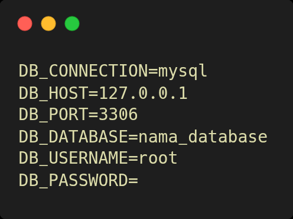

_Gambar 2.1: Konfigurasi koneksi database di file .env_

Catatan: Default Laragon dan XAMPP menggunakan user root tanpa password.

Jika sebelumnya sudah mengatur password MySQL sendiri, sesuaikan DB_PASSWORD

dengan password tersebut.

**Langkah 4. Tes Koneksi**

Setelah database dibuat dan .env dikonfigurasi, jalankan perintah berikut untuk

memastikan koneksi berhasil:

_Gambar 2.2: Perintah tes koneksi database (migrate)_

Jika tabel-tabel bawaan Laravel (migrations, users, dll.) berhasil dibuat tanpa

error, artinya koneksi ke database sudah terhubung. Bisa juga digunakan perintah berikut

untuk mengecek status koneksi tanpa menjalankan migration:

_Gambar 2.3:  Perintah tes koneksi tanpa migration_

8

Jika perubahan pada .env tidak terlihat efeknya (misalnya koneksi database

masih error meski konfigurasi sudah benar), kemungkinan Laravel masih membaca

konfigurasi lama yang sudah ter-cache. Bersihkan cache konfigurasi dengan perintah:

_Gambar 2.4: Perintah membersihkan cache konfigurasi (config:clear)_

**2.2. Migration**

Migration adalah cara Laravel mengelola struktur tabel database menggunakan kode

PHP, sehingga perubahan struktur tabel dapat dilacak dan dibagikan antaranggota tim tanpa

perlu mengekspor dan mengimpor file SQL secara manual. Migration dibuat menggunakan

Artisan CLI yang sudah dipelajari pada Bab 1:

_Gambar 2.5: Perintah membuat file migration baru_

Perintah

tersebut

akan

menghasilkan

file

migration

baru

di

folder

database/migrations. Di dalam file tersebut, struktur tabel didefinisikan menggunakan

method up(), misalnya untuk membuat tabel products dengan beberapa kolom dasar:

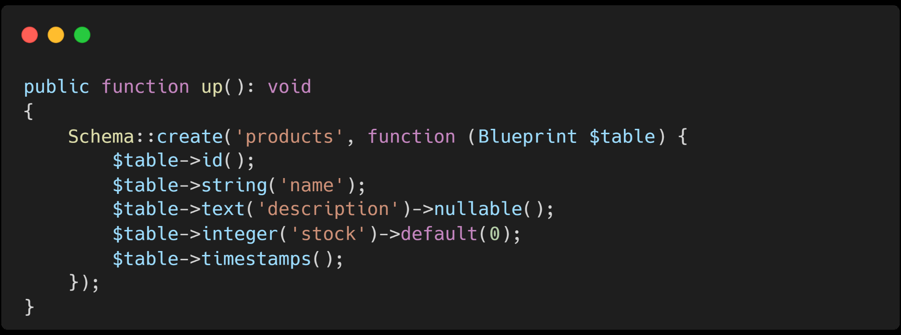

_Gambar 2.6: Contoh struktur kolom table products di method up()_

Method id() akan otomatis membuat kolom id sebagai primary key dengan tipe

auto-increment, sedangkan timestamps() akan membuat dua kolom sekaligus, yaitu

created_at dan updated_at untuk mencatat waktu data dibuat dan terakhir diperbarui.

Kolom yang bersifat opsional (boleh kosong) dapat ditambahkan method nullable(),

seperti pada kolom description di atas.

Jika suatu saat tabel perlu ditambah kolom baru, gunakan migration baru dengan

method Schema::table() (alter table), bukan mengubah migration yang sudah pernah

dijalankan:

9

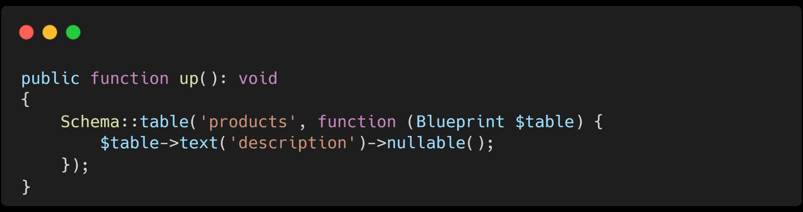

_Gambar 2.7: Contoh penggunaan Schema::table() untuk mengubah struktur tabel yang sudah_

_ada_

Jika tabel yang dibuat memiliki relasi ke tabel lain (akan dibahas lebih lanjut di Bab

4.2), kolom foreign key dapat langsung didefinisikan di migration menggunakan

foreignId() dan constrained():

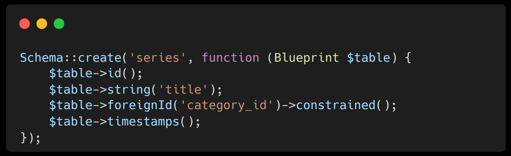

_Gambar 2.8: Contoh migration foreign key dengan foreignId() dan constrained()_

Method constrained() secara otomatis menghubungkan kolom category_id ke

tabel categories berdasarkan konvensi penamaan Laravel, sehingga tidak perlu menuliskan

nama tabel referensinya secara manual.

Setelah file migration siap, jalankan perintah berikut agar struktur table diterapkan ke

database:

_Gambar 2.9: Perintah menjalankan migration (php artisan migrate)_

Setiap kali membuat migration baru, jalankan kembali perintah php artisan migrate

untuk memperbarui struktur tabel di database.

10

Catatan: Jika suatu migration sudah pernah dijalankan (tercatat di tabel migrations),

lalu file migration tersebut diedit langsung, maka php artisan migrate tidak akan

berpengaruh apa pun. Laravel hanya mengecek apakah nama file migration sudah pernah

tercatat sebagai selesai, bukan apakah isinya sudah berubah. Akibatnya, akan muncul pesan

- Nothing to migrate” meskipun file sudah diubah.
Ada dua cara menangani hal ini, tergantung kebutuhan:

- ​ Jika data di database belum penting dan boleh hilang, gunakan php artisan
migrate:fresh untuk menghapus seluruh tabel dan menjalankan ulang semua

migration dari awal, termasuk migration yang baru diedit.

- ​ Jika data sudah ada dan tidak boleh hilang, jangan mengedit file migrasi yang sudah
ada. Buat migration baru khusus untuk mengubah struktur tabel menggunakan

Schema::table() dan method ->change():

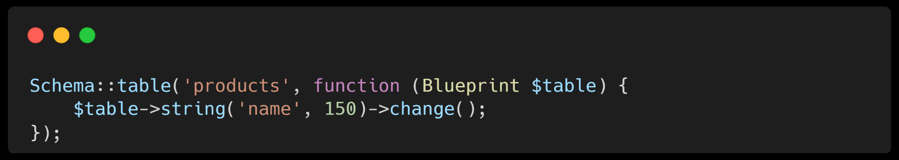

_Gambar 2.10: Contoh migration mengubah kolom dengan method change()_

Karena file ini baru dan belum pernah tercatat sebagai migration yang sudah

dijalankan, php artisan migrate biasa (tanpa fresh) sudah cukup untuk

menerapkannya.

Catatan tambahan: sejak Laravel 11 (termasuk Laravel 12), method ->change()

sudah bisa digunakan langsung tanpa perlu menginstal doctrine/dbal seperti pada versi

Laravel yang lebih lama. Namun, saat memakai ->change(), seluruh atribut kolom yang

ingin dipertahankan (misalnya nullable() atau default()) harus ditulis ulang secara

eksplisit, karena atribut yang tidak disertakan akan hilang setelah perubahan diterapkan.

**2.3. Eloquent ORM**

Eloquent

adalah

ORM

(Object-Relational

Mapping)

bawaan

Laravel

yang

memungkinkan setiap tabel di database direpresentasikan sebagai sebuah class PHP

(Model), mirip dengan konsep class pada OOP yang sudah dipelajari pada Modul 3.

Bedanya, model pada Eloquent secara otomatis terhubung ke tabel di database tanpa perlu

menulis query SQL secara manual.

_Gambar 2.11: Perintah membuat model via Artisan_

Di dalam Model, properti fillable digunakan untuk menentukan kolom mana saja

yang boleh diisi melalui mass assignment (misalnya saat menerima data dari request API):

11

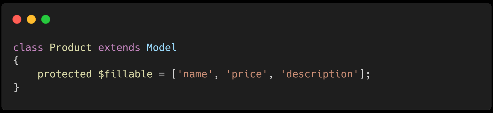

_Gambar 2.12: Contoh properti fillable pada Model_

Selain fillable, Eloquent juga menyediakan casting untuk mengubah tipe data kolom

secara otomatis saat diambil dari database, misalnya mengubah kolom bertipe JSON

menjadi array:

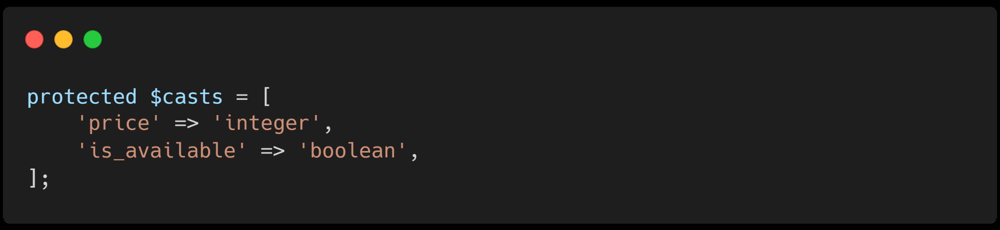

_Gambar 2.13: Contoh casting kolom (misalnya JSON ke array)_

Dengan Eloquent, operasi dasar pada database menjadi jauh lebih ringkas. Misalnya,

mengambil seluruh data cukup dengan Product::all() tanpa perlu menulis query SQL

secara manual.

**2.4. Accessor, Mutator & Query Scope**

Selain fillable dan casting, Eloquent menyediakan dua cara untuk memformat data

secara otomatis: accessor untuk memformat data saat dibaca, dan mutator untuk

memformat data sebelum disimpan. Keduanya berguna agar logika format data tidak perlu

ditulis ulang di setiap Controller.

12

Contoh accessor untuk menampilkan harga produk dalam format Rupiah setiap kali

diakses:

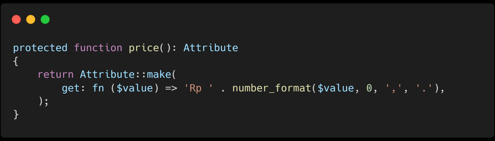

_Gambar 2.14: Contoh accessor untuk format harga Rupiah_

Dengan accessor ini, memanggil $product->price akan otomatis menghasilkan

format "Rp 50.000" tanpa perlu memformat manual di setiap tempat data ditampilkan.

Selain accessor/mutator, Eloquent juga menyediakan query scope, yaitu method

reusable untuk memfilter query yang sering digunakan. Scope didefinisikan di dalam Model

dengan awalan scope:

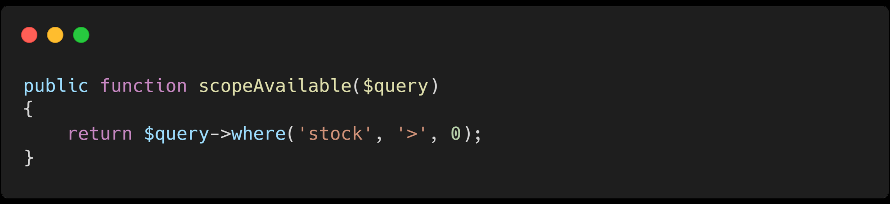

_Gambar 2.15: Contoh query scope pada Model_

Scope ini kemudian bisa dipanggil langsung tanpa menuliskan where() berulang kali:

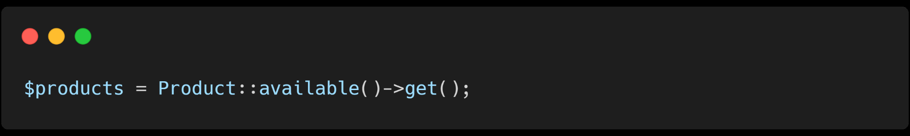

_Gambar 2.16: Contoh pemanggilan query scope tanpa where() berulang_

Pendekatan ini membuat query yang sering dipakai (misalnya "produk yang masih

tersedia") cukup ditulis sekali di Model, lalu dipakai kembali di berbagai Controller tanpa

duplikasi kode.

**2.5. Seeder & Factory**

Untuk kebutuhan development, terkadang diperlukan data dummy agar aplikasi

dapat langsung diuji tanpa harus menginput data satu per satu secara manual. Seeder dan

Factory dapat digunakan untuk keperluan ini.

13

Factory dibuat menggunakan Artisan CLI:

_Gambar 2.17: Perintah membuat factory via Artisan_

Di dalam file factory, gunakan Faker untuk menghasilkan data acak yang realistis:

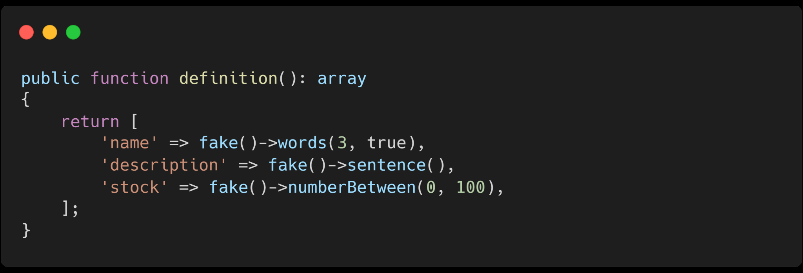

_Gambar 2.18: Contoh penggunaan Faker dalam factory_

Setelah factory siap, panggil di dalam Seeder untuk membuat data sebanyak yang

dibutuhkan:

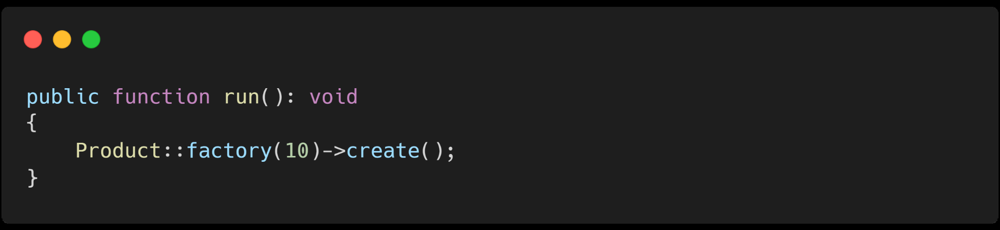

_Gambar 2.19: Contoh pemanggilan factory di dalam Seeder_

Jalankan seeder dengan perintah:

_Gambar 2.20:Perintah menjalankan seeder (db:seed)_

Jika ingin mengulang dari database yang bersih (menghapus seluruh tabel lalu

migrate ulang sekaligus mengisi data dummy), gunakan:

_Gambar 2.21: Perintah migrate:fresh --seed_

Bagian ini bersifat opsional dan dapat digunakan sesuai kebutuhan selama proses

pengembangan berlangsung.

14

**3.​ Controller, Routing & Validasi**

Setelah model dan database siap, langkah berikutnya adalah membuat jalur agar klien

(misalnya Postman atau frontend) dapat berkomunikasi dengan data tersebut. Jika pada Modul

2 komunikasi client-server dilakukan menggunakan Fetch API dari sisi browser, maka pada

bagian ini kita akan membangun sisi server yang menerima dan merespons permintaan

tersebut menggunakan Controller dan routing di Laravel.

**3.1. Controller & API Resource**

Controller adalah class yang bertugas menangani logika request dan response, mirip

dengan method pada class yang sudah dipelajari di Modul 3, namun kini method-nya khusus

menangani permintaan dari client. Controller dibuat menggunakan Artisan CLI dengan

tambahan opsi --resource agar otomatis berisi method-method CRUD standar (index, show,

store, update, destroy):

_Gambar 3.1: Perintah membuat Controller dengan opsi --resource_

Agar response JSON yang dikirim ke client memiliki format yang konsisten, Laravel

menyediakan API Resource. API Resource dibuat dengan perintah:

_Gambar 3.2: Perintah membuat API Resource_

Contoh penggunaan sederhana di dalam ProductResource:

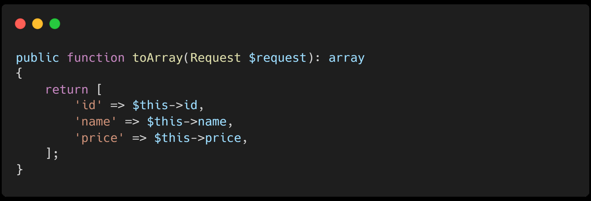

_Gambar 3.3: Contoh isi ProductResource_

Dengan cara ini, format respons JSON akan selalu konsisten meskipun struktur data

di database berubah, karena penyesuaian hanya dilakukan di satu tempat, yaitu di dalam

Resource.

15

**3.2. API Routing**

Seluruh endpoint API di Laravel didaftarkan di file routes/api.php. Setiap route

menghubungkan sebuah URL dan HTTP method (yang sudah dipelajari konsepnya di Modul

2) ke method tertentu di dalam Controller:
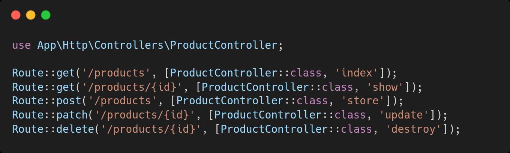

_Gambar 3.4: Contoh pendaftaran route CRUD secara manual di routes/api.php_

Menuliskan setiap route CRUD secara manual seperti di atas cukup memakan

banyak baris kode. Laravel menyediakan cara yang lebih ringkas menggunakan

Route::apiResource(), yang otomatis mendaftarkan seluruh route CRUD standar

(index, show, store, update, destroy) hanya dalam satu baris:

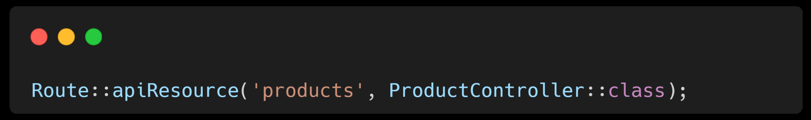

_Gambar 3.5: Contoh penggunaan Route::apiResource()_

Route ini setara dengan menuliskan kelima route secara manual seperti contoh

sebelumnya, namun lebih ringkas dan menjadi cara yang lebih umum digunakan dalam

proyek Laravel.

Untuk mengecek seluruh route yang sudah terdaftar beserta method dan

Controller-nya, gunakan perintah Artisan berikut:

_Gambar 3.6: Perintah php artisan route:list_

Perintah ini sangat membantu untuk memastikan tidak ada rute yang salah ketik

atau bertabrakan sebelum diuji menggunakan Postman.

16

**3.3. Form Request Validation**

Sebelum data masuk ke database, input dari klien perlu divalidasi terlebih dahulu di

sisi server. Berbeda dengan validasi di Modul 2 yang dilakukan langsung di browser

menggunakan JavaScript, validasi di sisi server memastikan data tetap aman meskipun

request datang bukan dari halaman web yang sudah dibuat (misalnya dikirim langsung

lewat Postman).

Form Request dibuat menggunakan Artisan CLI:

_Gambar 3.7: Perintah membuat Form Request via Artisan_

Di dalam file tersebut, aturan validasi dan pesan error didefinisikan sebagai berikut:

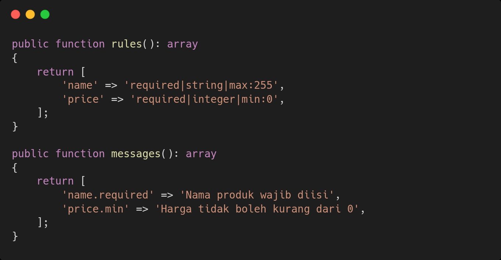

_Gambar 3.8: Contoh aturan validasi dan pesan error pada Form Request_

Form Request ini kemudian dipanggil langsung sebagai parameter di method

Controller, sehingga validasi otomatis dijalankan sebelum kode di dalam method dieksekusi:

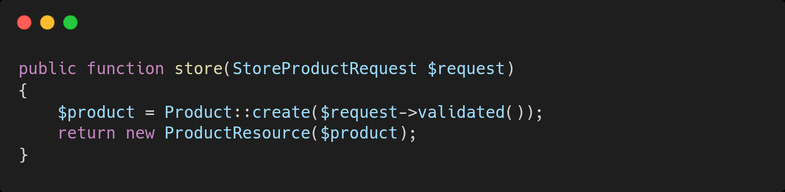

_Gambar 3.9: Contoh pemanggilan Form Request sebagai parameter Controller_

17

Jika validasi gagal, Laravel secara otomatis mengembalikan response error beserta

pesan yang sudah didefinisikan, tanpa perlu menulis pengecekan manual di dalam

Controller.

Catatan: Aturan di atas menggunakan required dan cocok untuk method POST. Jika

Form Request yang sama dipakai untuk PATCH (update sebagian data), gunakan rule

sometimes agar field yang tidak dikirim tidak dianggap error:

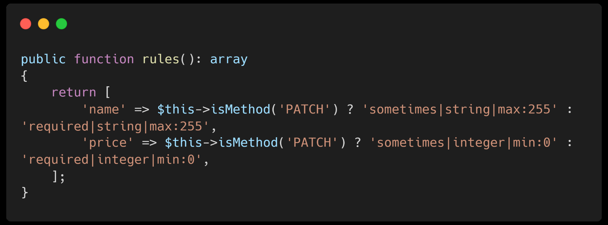

_Gambar 3.10: Contoh rule sometimes untuk method PATCH_

Jika validasi gagal, Laravel otomatis mengirim response dengan status 422:

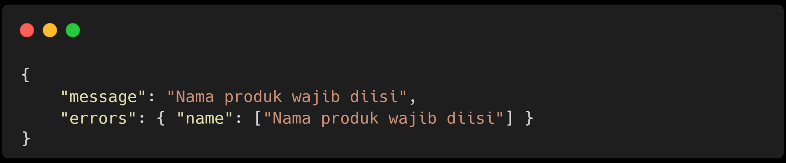

_Gambar 3.11: Contoh respons JSON ketika validasi gagal dengan status 422_

**4.​ CRUD API & Relationship**

Setelah Controller, routing, dan validasi siap, bagian ini akan menggabungkan semuanya

menjadi satu alur CRUD (Create, Read, Update, Delete) yang lengkap. Konsep HTTP method

untuk masing-masing operasi sudah dibahas pada Modul 2, sehingga pada bagian ini fokus

utamanya adalah implementasinya di Laravel.

18

**4.1. CRUD API Lengkap**

_Tabel 4.1: Ringkasan operasi CRUD API (operasi, HTTP method, endpoint, method Controller)_

**Operasi**

**HTTP Method**

**Endpoint**

**Method Controller**

Ambil semua data

GET

/products

index()

Ambil satu data

GET

/products/{id}

show()

Tambah data

POST

/products

store()

Ubah data

PATCH

/products/{id}

update()

Hapus data

DELETE

/products/{id}

destroy()

Sebelum masuk ke implementasi, perlu diketahui fitur Route Model Binding Laravel

dapat otomatis mengambil data berdasarkan ID di URL cukup dengan type-hint nama Model

di parameter, tanpa perlu findOrFail() manual:

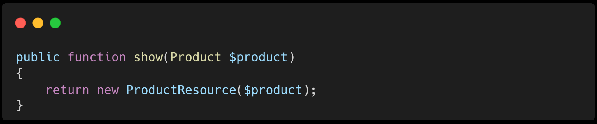

_Gambar 4.1: Contoh Route Model Binding_

Laravel secara otomatis mencari data berdasarkan ID pada route dan langsung

mengembalikan 404 jika data tidak ditemukan. Contoh method show(), update(),dan

destroy() di bawah ini menggunakan pendekatan ini.

Contoh implementasi GET All dengan pagination, agar data yang ditampilkan

tidak sekaligus dalam jumlah besar:

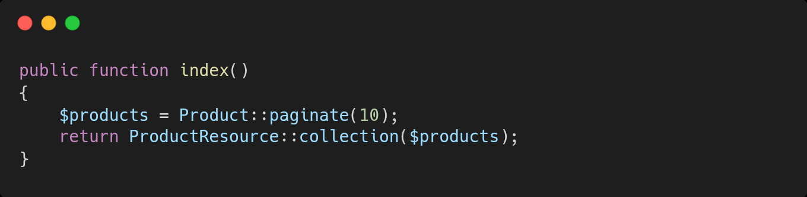

_Gambar 4.2: Contoh implementasi GET All dengan pagination_

19

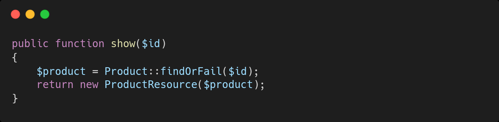

_Gambar 4.3: Contoh implementasi GET by ID_

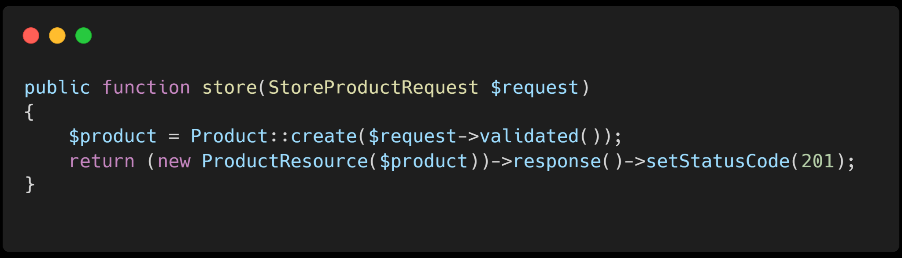

_Gambar 4.4: Contoh implementasi POST dengan Form Request_

Kode 201 menandakan data berhasil dibuat, sesuai konsep HTTP status code yang

telah dipelajari pada Modul 2. Praktik ini penting agar client (frontend) dapat membedakan

respons sukses pembuatan data baru (201) dengan respons sukses biasa (200).

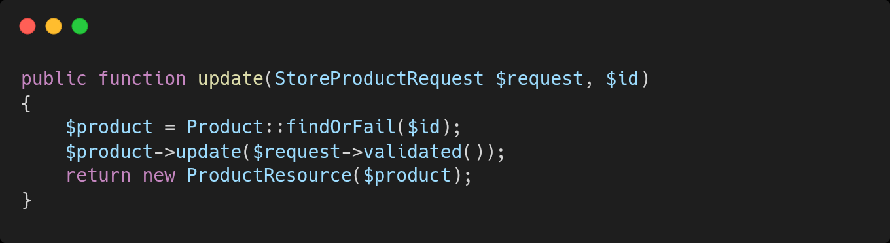

_Gambar 4.5: Contoh implementasi PATCH_

Contoh implementasi DELETE. Jika ingin menerapkan soft delete (data tidak dihapus

permanen, hanya ditandai terhapus), tambahkan trait SoftDeletes pada Model dan kolom

deleted_at pada migration:

20

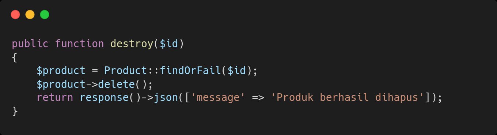

_Gambar 4.6: Contoh implementasi DELETE (dengan opsi SoftDeletes)_

Catatan: Penerapan soft delete bersifat opsional dan dapat disesuaikan dengan

kebutuhan studi kasus masing-masing.

**4.2. Eloquent Relationship**

Dalam aplikasi nyata, data antartabel saling berhubungan. Misalnya, satu Category

dapat memiliki banyak Product, dan satu Product hanya dimiliki oleh satu Category. Relasi

ini disebut hasMany dan belongsTo dan didefinisikan langsung di dalam Model, mirip

dengan cara method didefinisikan di dalam class pada Modul 3.

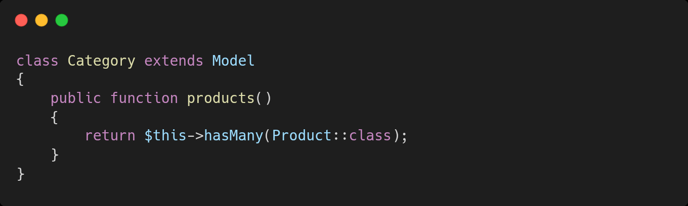

_Gambar 4.7: Contoh relasi hasMany pada Model Category_

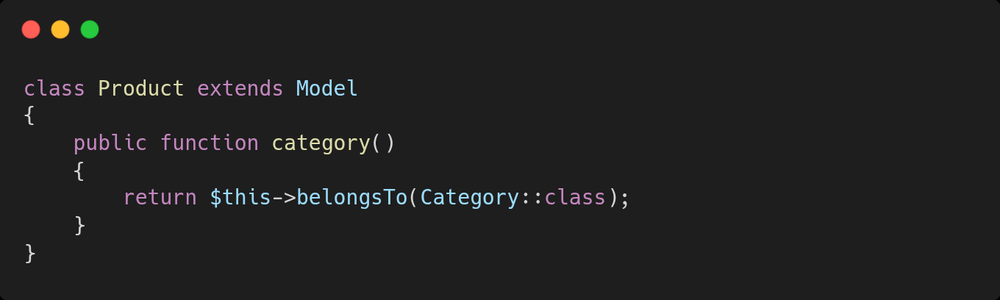

_Gambar 4.8: Contoh relasi belongsTo pada Model Product_

21

Dengan relasi ini, data dari kedua tabel dapat diambil sekaligus tanpa perlu menulis

query manual, misalnya menampilkan seluruh produk beserta kategorinya:

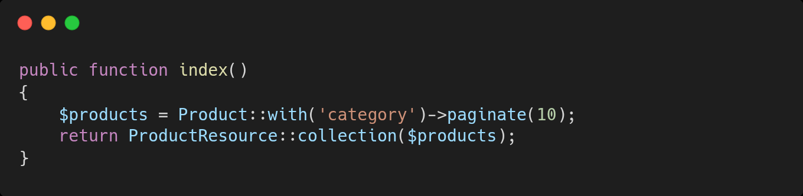

_Gambar 4.9: Contoh eager loading dengan with()_

Method with() digunakan untuk memuat data relasi secara langsung (disebut

eager loading), sehingga informasi kategori otomatis tersedia setiap kali data produk

diambil.

**4.3. Relasi Many-to-Many (belongsToMany)**

Selain hasMany/belongsTo (satu-ke-banyak), ada kondisi ketika dua entitas saling

memiliki banyak data satu sama lain. Contohnya, satu Media bisa dikoleksi oleh banyak

Pengguna, dan satu Pengguna bisa mengoleksi banyak Media. Relasi ini disebut

belongsToMany (many-to-many) dan membutuhkan satu tabel tambahan, yaitu tabel pivot

untuk menyimpan pasangan relasi tersebut.

Pivot table dibuat lewat migration seperti table biasa, namun hanya berisi kolom

foreign key dari kedua entitas:

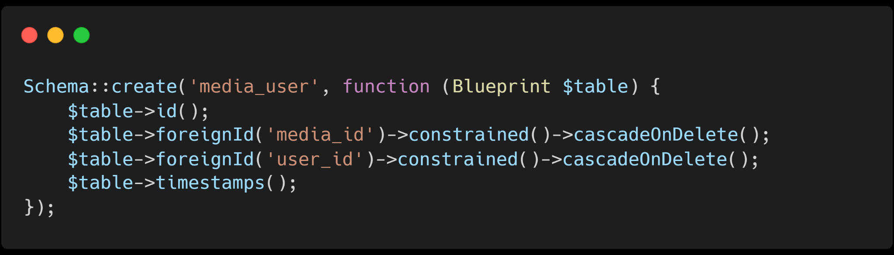

_Gambar 4.10: Contoh migration pivot table_

Nama tabel pivot mengikuti konvensi Laravel: gabungan nama kedua model dalam

bentuk singular, diurutkan alfabetis (media_user, bukan user_media).

22

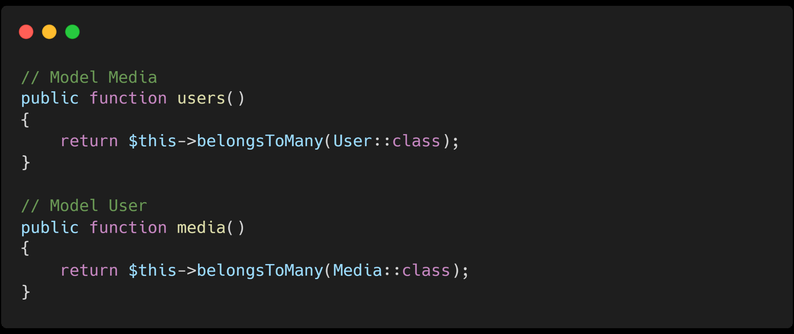

_Gambar 4.11: Contoh definisi relasi belongsToMany di kedua model_

Untuk menambah atau menghapus relasi (misalnya menambahkan media ke koleksi

pengguna), gunakan method attach() dan detach(). Ini tidak memerlukan Controller

CRUD standar karena sifatnya mengubah relasi, bukan membuat/menghapus data Media itu

sendiri:

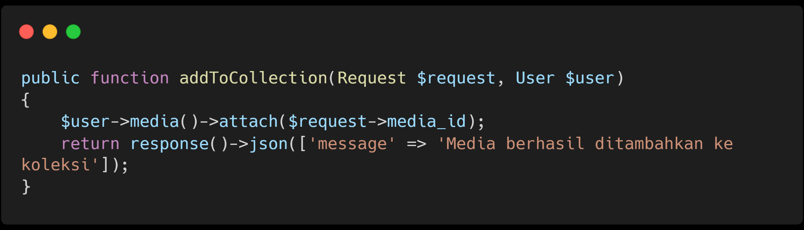

_Gambar 4.12: Contoh penggunaan attach()_

Method attach() akan menambahkan baris baru ke dalam pivot table, sedangkan

detach() akan menghapusnya. Custom action seperti ini perlu didaftarkan sebagai route

tambahan di luar Route::apiResource(), misalnya:

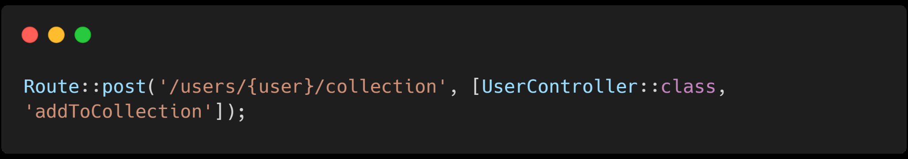

_Gambar 4.13: Contoh route tambahan untuk custom action_

23

**4.4. Menjaga Konsistensi Data pada Custom Action (Race Condition)**

Custom action seperti attach()/detach() pada contoh sebelumnya relatif aman

karena hanya menambah atau menghapus baris pada pivot. Namun, custom action yang

membaca kondisi data lalu mengubahnya, misalnya memeriksa apakah sebuah item masih

tersedia, lalu menandainya sebagai tidak tersedia, berisiko tidak terlihat saat diuji sendirian

di Postman karena race condition.

Bayangkan dua request berikut masuk ke server pada waktu yang hampir

bersamaan, untuk meminjam buku yang sama:

1.​

Request A membaca is_available → bernilai true

2.​

Request B membaca is_available → bernilai true (belum sempat diubah oleh A)

3.​

Request A mengubah is_available menjadi false, menyimpan

4.​

Request B mengubah is_available menjadi false, menyimpan

Karena langkah baca dan langkah ubah tidak terjadi dalam satu operasi yang "tidak

bisa diselingi", kedua request sama-sama lolos pengecekan dan sama-sama berhasil,

padahal buku fisiknya cuma satu. Ini tidak akan pernah muncul saat diuji manual satu per

satu di Postman, karena kondisi ini hanya terjadi jika dua request benar-benar tumpang

tindih waktunya.

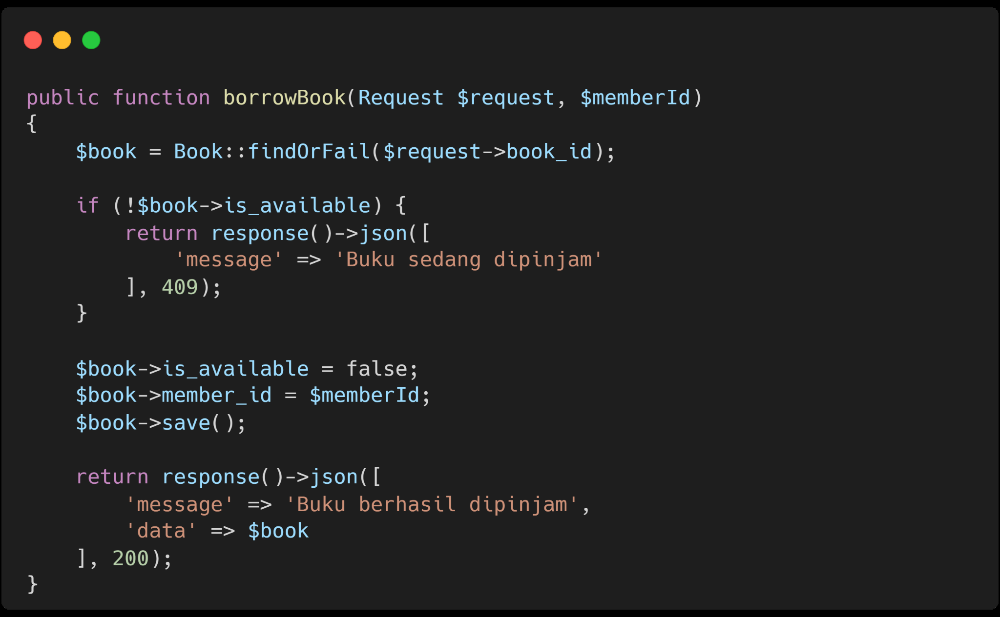

_Gambar 4.14: Contoh borrowBook() tanpa proteksi race condition (rawan double-booking)_

Kalau dua request untuk book_id yang sama masuk hampir bersamaan, keduanya

bisa sama-sama lolos pengecekan if (!$book->is_available) sebelum salah

24

satunya sempat menyimpan. Akibatnya, buku yang sama tercatat dipinjam oleh dua anggota

sekaligus.

Untuk mencegah ini, Laravel menyediakan dua alat:

1.​ DB::transaction() membungkus beberapa query menjadi satu unit, supaya kalau ada

bagian yang gagal, semua perubahan dibatalkan (rollback), bukan hanya tersimpan

sebagian.

2.​ lockForUpdate() mengunci baris yang sedang dibaca selama transaksi berlangsung,

sehingga request lain yang mencoba membaca baris yang sama harus menunggu

hingga transaksi pertama selesai. Tanpa ini, DB::transaction() saja tidak cukup; kedua

request tetap bisa membaca nilai true secara bersamaan sebelum salah satunya

sempat menyimpan perubahan.

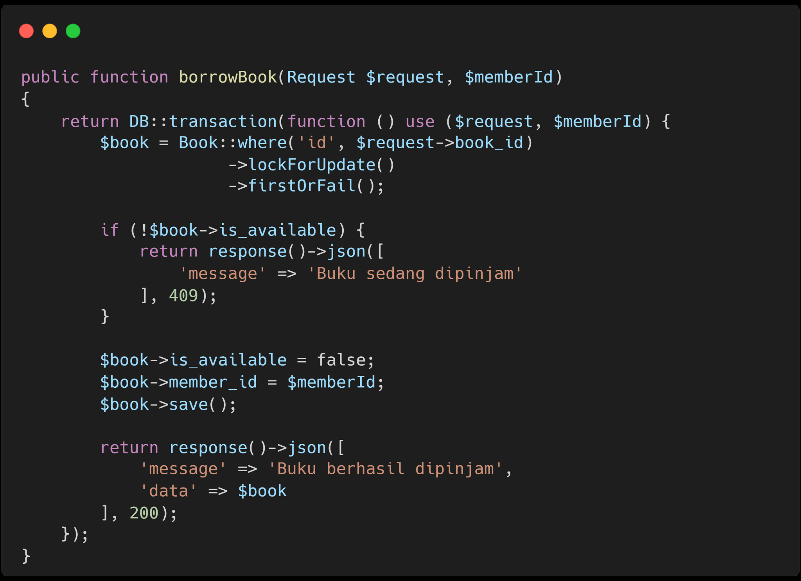

_Gambar 4.15: Contoh borrowBook() dengan DB::transaction() dan lockForUpdate()_

Dengan lockForUpdate(), request B akan menunggu sampai transaksi request A

selesai (baik berhasil maupun rollback), lalu membaca ulang data yang sudah diperbarui,

sehingga akan mendapati is_available sudah false dan menolak peminjaman dengan benar.

Catatan: proteksi ini tidak wajib diterapkan pada semua endpoint; hanya relevan untuk

custom action yang polanya "baca kondisi → validasi → ubah kondisi" pada data yang

sama, seperti borrow-book pada Codelab. Endpoint CRUD standar (store, update biasa)

umumnya tidak butuh ini kecuali ada pengecekan serupa di dalamnya.

25

**4.5. Pengujian Endpoint**

Seluruh endpoint yang telah dibuat dapat diuji menggunakan Postman, sesuai

dengan cara yang telah dipelajari pada Modul 2. Pastikan setiap endpoint diuji satu per satu,

mulai dari GET, POST, PATCH, hingga DELETE, untuk memastikan respons JSON yang

dihasilkan sesuai dengan format yang telah didefinisikan dalam API Resource.

**4.6. Error Handling Dasar**

Selain validasi input, ada kasus error lain yang perlu ditangani secara manual di

Controller. Contohnya saat mencoba menambahkan media yang sama dua kali ke koleksi

pengguna yang sama, Laravel tidak akan otomatis menolak ini kecuali dicek terlebih dahulu:

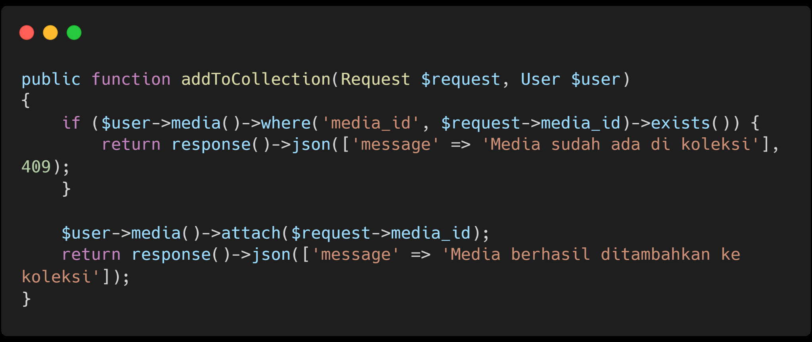

_Gambar 4.16: Contoh pengecekan data duplikat dan respons status 409_

Status 409 (Conflict) dipakai untuk menandakan request valid secara format, tetapi

bertentangan dengan kondisi data yang sudah ada.

_Tabel 4.2: Ringkasan HTTP status code_

**Status Code**

**Arti**

**Contoh Kasus**

200

OK

Data berhasil diambil/diubah

201

Created

Data baru berhasil dibuat

404

Not Found

ID yang dicari tidak ditemukan

409

Conflict

Data duplikat, misalnya media sudah ada di

koleksi

422

Unprocessable Entity

Validasi input gagal

26

**CODELAB**

**Melengkapi REST API Peminjaman Buku Perpustakaan**

Kembangkan REST API sistem perpustakaan yang telah disiapkan pada repository berikut:

CODELAB-4-WEB, dengan melengkapi kemampuan API agar anggota perpustakaan (Member)

dapat meminjam dan mengembalikan buku (Book) melalui endpoint yang disediakan.

**Setup Awal**

Setelah meng-clone repository, lakukan langkah berikut secara berurutan sebelum mulai

mengerjakan:

1.​ Copy .env.example menjadi .env, sesuaikan konfigurasi database

2.​ composer install

3.​ php artisan key:generate

4.​ php artisan migrate --seed

Perintah terakhir akan sekaligus membuat struktur tabel dan mengisi data dummy member

melalui seeder yang sudah disiapkan. Data dummy ini diperlukan karena endpoint borrow-book

dan return-book membutuhkan {id} member yang valid — tanpa seeder, tabel members masih

kosong dan tidak ada ID yang bisa diuji.

**Catatan Pengerjaan**

Pada codelab ini, beberapa bagian kode telah dibuat dalam bentuk rumpang (ditandai dengan

komentar TODO). Lengkapilah bagian yang masih rumpang tersebut sesuai petunjuk yang

diberikan menggunakan konsep Eloquent ORM, Relationship, dan API Resource yang telah

dipelajari pada modul ini.

**Perhatian**

routes/api.php yang tersedia saat ini hanya mendaftarkan Route::apiResource() untuk

books dan members. Method borrowBook() dan returnBook() di MemberController tidak

dapat diakses tanpa route tambahan. Tambahkan route secara manual sebagai bagian dari

codelab.

**Referensi Kode yang Sudah Lengkap**

Gunakan file-file berikut sebagai contoh format penulisan (tidak perlu diubah):

- ​ app/Models/Book.php — referensi penulisan relasi belongsTo
- ​ app/Http/Controllers/BookController.php — referensi CRUD Controller
standar

- ​ app/Http/Requests/StoreBookRequest.php — referensi Form Request dengan
aturan berbeda untuk POST/PATCH

- ​ app/Http/Resources/BookResource.php — referensi format API Resource dengan
whenLoaded

27

**Output yang Diharapkan**

Apabila implementasi dilakukan dengan benar, pengujian di Postman berikut harus berjalan

sesuai alur:

1.​ POST /api/members/{id}/borrow-book dengan body { "book_id": 1 } →

buku berhasil dipinjam, is_available menjadi false

2.​ GET /api/members/{id} → menampilkan data member beserta daftar buku yang

sedang dipinjam

3.​ PATCH /api/members/{id}/return-book/{book_id} → buku berhasil

dikembalikan, is_available menjadi true kembali, member_id menjadi null

**Troubleshooting**

Jika perlu mengulang setup dari awal (misalnya data member terlanjur terduplikasi karena

seeder dijalankan lebih dari sekali), gunakan php artisan migrate:fresh --seed —

bukan migrate --seed saja — agar seluruh tabel dan data dihapus bersih sebelum diisi

ulang.

28

**DEMO**

Demo ini melanjutkan pengembangan FlipPlay yang sebelumnya dibangun sebagai simulasi

OOP berbasis terminal pada Modul 3 dan kini dikembangkan menjadi REST API menggunakan

Laravel 12. Jika pada Modul 3 fokus utamanya adalah penerapan konsep OOP (class, object,

encapsulation, inheritance), maka pada modul ini fokus utamanya adalah menghubungkan

logika tersebut ke database sungguhan dan mengeksposnya sebagai endpoint API yang dapat

diakses oleh client, misalnya Postman atau aplikasi frontend.

Struktur entitas FlipPlay yang sudah dirancang di Modul 3 (Media dan Pengguna/koleksi media)

tetap dipertahankan, namun kini direpresentasikan sebagai Model Eloquent yang tersimpan di

database, lengkap dengan Migration, Controller, Routing, dan Validasi.

**Ketentuan Demo**

Prototype API yang dibuat wajib memenuhi ketentuan berikut:

- ​ Buat satu repositori github dan buat project Laravel di repositori tersebut
- ​ Menggunakan minimal dua entitas dengan relasi Eloquent (misalnya Media dan
Pengguna, dengan relasi belongsToMany untuk merepresentasikan koleksi media milik

pengguna)

- ​ Setiap entitas memiliki Migration yang mendefinisikan struktur tabel dengan benar,
termasuk foreign key/pivot table jika relasinya many-to-many

- ​ Menerapkan Controller dengan method CRUD standar (index, show, store, update,
destroy) untuk entitas Media

- ​ Menggunakan Form Request Validation pada endpoint yang menerima input
(POST/PATCH), misalnya validasi judul media wajib diisi dan tidak boleh duplikat

- ​ Menerapkan API Resource agar format response JSON konsisten, termasuk saat
menampilkan relasi (whenLoaded)

- ​ Seluruh endpoint didaftarkan di routes/api.php dan dapat diverifikasi melalui php
artisan route:list

- ​ Menerapkan minimal satu custom action di luar CRUD standar yang melibatkan
perubahan relasi antartabel, misalnya menambahkan media ke koleksi pengguna atau

menghapus media dari koleksi

**Alur yang Diharapkan**

Variasi endpoint tambahan dapat ditentukan secara bebas selama masih sesuai dengan studi

kasus FlipPlay. Sebagai contoh, demo dapat mencakup proses:

- ​ Menambahkan media baru ke dalam sistem (judul, jenis, genre, dll.)
- ​ Menampilkan daftar seluruh media yang tersedia di FlipPlay
- ​ Menampilkan detail satu media beserta pengguna yang memasukkannya ke koleksi
- ​ Mencari media berdasarkan judul (query filter pada endpoint index)
- ​ Menambahkan media ke dalam koleksi pribadi pengguna
- ​ Menampilkan koleksi media yang dimiliki seorang pengguna

29

- ​ Menghapus media dari koleksi pengguna
**Pengujian**

Seluruh endpoint wajib diuji satu per satu menggunakan Postman, mencakup skenario berhasil

(happy path) dan skenario gagal, misalnya menambahkan media dengan judul kosong atau

menambahkan media yang sama dua kali ke koleksi pengguna yang sama, untuk memastikan

validasi dan respons error berjalan sesuai harapan.

30

**RUBRIK PENILAIAN**

**Aspek Penilaian**

**Poin (%)**

**Codelab**

**Total 10%**

Berhasil melengkapi bagian rumpang (TODO) menggunakan

Eloquent ORM, Relationship & API Resource

5

Output sesuai alur yang diharapkan (borrow-book → get

member → return-book)

5

**Demo**

**Total 80%**

CRUD API lengkap (index, show, store, update, destroy) dengan

status code tepat

20

Eloquent Relationship (migration, relasi antar entitas, eager

loading)

20

Form Request Validation & penanganan error 422

15

API

Resource

(format

response

konsisten,

termasuk

whenLoaded)

10

| Custom action di luar CRUD standar (attach/detach relasi) | 10 |
| --- | --- |
| Pengujian endpoint — happy path & failure path (Postman) | 5 |
| Pemahaman | Total 10% |
| Ketepatan menjawab pertanyaan | 10 |

31
